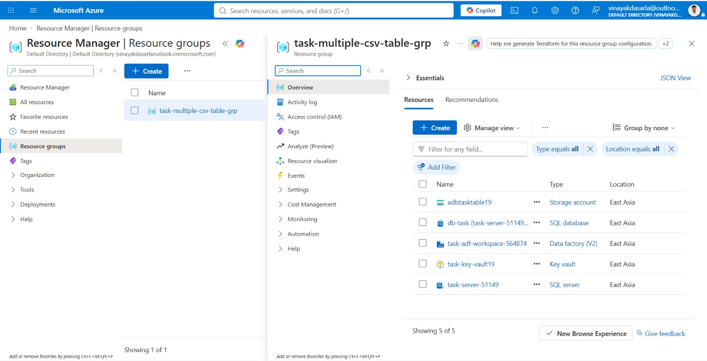
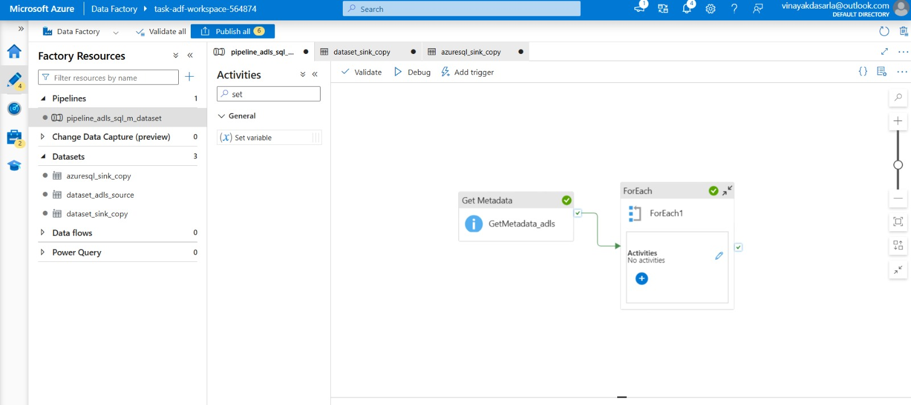
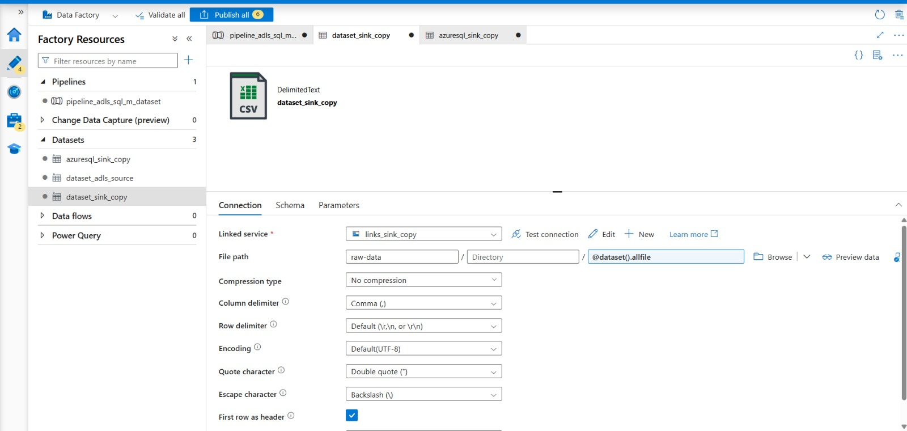
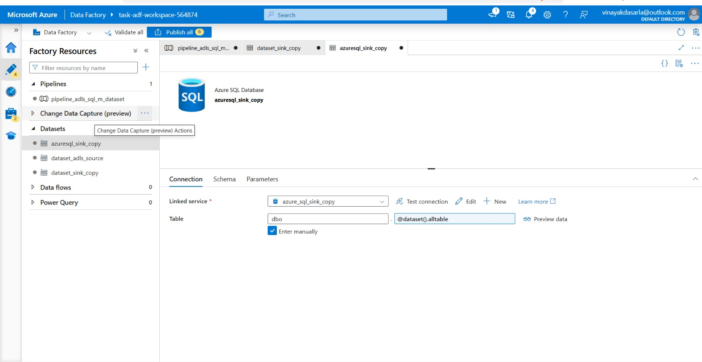
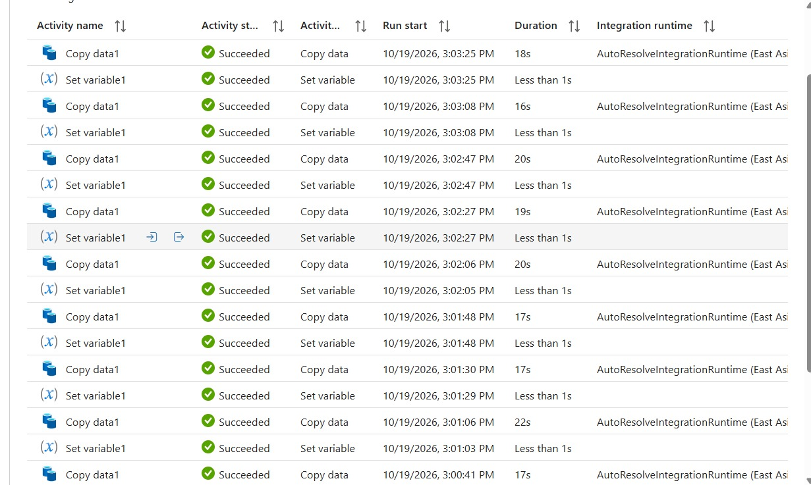

# Metadata-Driven CSV Ingestion Pipeline in Azure Data Factory

## 📌 Project Overview
Built an automated, scalable ETL pipeline using Azure Data Factory to dynamically ingest multiple CSV files from Azure Data Lake Storage (ADLS) into separate tables in an Azure SQL Database.

## 🛠️ Architecture & Tools
*   **Orchestration:** Azure Data Factory (ADF)
*   **Storage:** Azure Data Lake Storage Gen2 (ADLS)
*   **Database:** Azure SQL Database
*   **Security:** Azure Key Vault (secrets management) & Managed Identities

## 🚀 Key Implementations & Achievements
*   **Metadata-Driven Design:** Utilized `Get Metadata` and `ForEach` activities to dynamically loop through all files in the source directory, eliminating the need for hardcoded pipelines.
*   **Full Parameterization:** Configured Datasets with dynamic parameters (`@dataset().allfile` for source, `@dataset().alltable` for sink) to automatically route data to the correct SQL tables based on the input file.
*   **Security Best Practices:** Secured database credentials using Azure Key Vault and integrated ADF with Managed Identities, avoiding hardcoded passwords in connection strings.
*   **Successful Execution:** Validated the end-to-end pipeline (seen in monitor logs), successfully copying multiple files with 100% success rate and zero manual intervention required for subsequent file drops.

---

## 📸 Project Screenshots

### 1. Resource Group Setup

### 2. Pipeline Orchestration (Get Metadata -> ForEach)

### 3. Parameterized Source Dataset (ADLS)

### 4. Parameterized Sink Dataset (Azure SQL)

### 5. Successful Execution Monitor Logs

---

## 📂 Pipeline Code
The complete JSON configuration for the pipeline, demonstrating the dynamic parameterization logic, is available in the repository:
*   [View pipeline_code.json](./pipeline_code.json)
